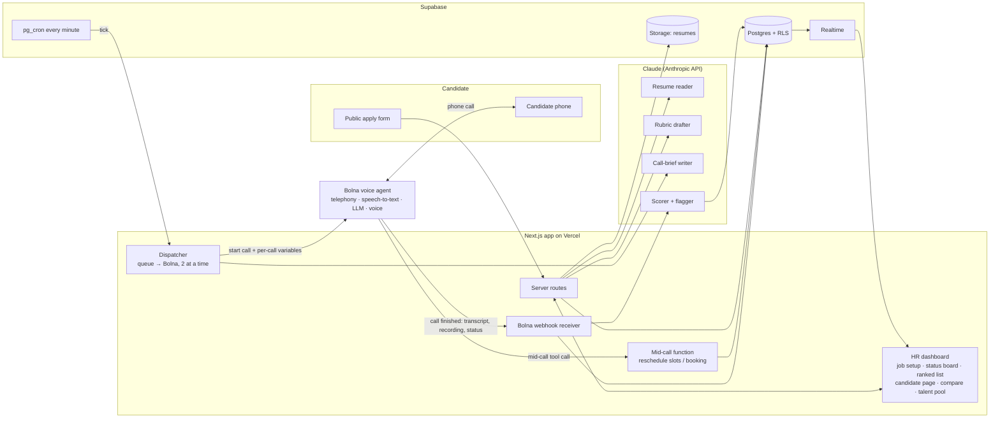

# System architecture: Hirefy (hackathon build)

**Version:** 1 · **Date:** 2026-11-15 · **Source of truth for product:** `prd.md` (v3)
Small changes are expected. Anything marked **VERIFY** must be checked against Bolna docs (or the Bolna MCP) before building on it.

---

## 1. Shape of the system

One Next.js app on Vercel (HR dashboard + public apply form + all server routes), Supabase for data/auth/files/live updates, Claude for all text intelligence, Bolna for the phone call. No separate Python service: fewer moving parts for a 24–48h build.

## 2. Components

| # | Component | Runs on | Does |
|---|---|---|---|
| C1 | **HR dashboard** | Next.js (App Router), Tailwind, shadcn | Job setup, status board, ranked list, candidate page (audio + transcript + quotes), compare, talent pool, CSV import/export |
| C2 | **Public apply form** | Next.js page | Name, phone, email, resume, consent tick with data notice. Phone check by one-time code (**P1**; hackathon: rate limit + dedupe) |
| C3 | **Server routes** | Next.js route handlers | All reads/writes, behind Supabase auth; validates input |
| C4 | **Dispatcher** | Route `/api/dispatch`, ticked by Supabase `pg_cron` + `pg_net` every minute, and also kicked right after "Start screening" and after every finished call | Picks due calls (queued or rescheduled, inside calling hours), keeps ≤ concurrency limit (2) in flight, builds call brief, starts Bolna call, handles retries (max 3, spaced) |
| C5 | **Webhook receiver** | Route `/api/webhooks/bolna` | Verifies shared secret, idempotent on Bolna execution id, stores transcript/recording/status/duration/cost, classifies outcome, queues scoring, kicks dispatcher |
| C6 | **Mid-call function** | Route `/api/bolna/reschedule` | Called by Bolna during the call: returns 3 free slots inside calling hours with spare capacity; books the chosen one (max 2 reschedules) |
| C7 | **AI services** | Server-side calls to Claude, structured JSON output | Resume reader, rubric drafter, call-brief writer, scorer + flagger (details §5) |
| C8 | **Bolna agent** | Bolna platform | One agent "Hirefy interviewer": prompt template with per-call variables, English + Hinglish, 10-min hard cap, hang-up on goodbye, reschedule tool, webhook to C5 |
| C9 | **Supabase** | Managed | Postgres with row-level security per company, Auth (email login), Storage (resumes, private), Realtime (live status + ranking) |
| C10 | **Heads-up message** | Mocked for hackathon | SMS/WhatsApp with time-pick link. Shown in UI as "sent"; real provider later |

## 3. Key flows

### 3.1 Job setup
1. HR creates job: title, job description, company culture values (3–5, a sentence each), company FAQ (pay band wording, location, process), calling hours, other open roles (from the company's other jobs).
2. **Rubric drafter** (Claude) proposes: must-haves, nice-to-haves, deal-breakers, and the **standard rubric** pre-filled: Skills 30 · Experience 30 · Culture fit 25 · Confidence 15. HR edits weights, adds custom traits (name + one sentence), saves. Each save = new rubric version.

### 3.2 Applicants in
- CSV/ZIP upload or apply form → candidate rows + resume files in Storage.
- **Resume reader** (Claude, PDF in) → structured profile (current role, years, skills, companies, location, notice period, languages, education) + a **resume-only score** against the rubric (for the "rescued" comparison).
- Dedupe by phone + email; invalid numbers flagged, not dropped. Phone normalised to +91 format.

### 3.3 Screening
1. HR clicks **Start screening** → all candidates `queued`; mock heads-up marked sent.
2. Dispatcher (every minute + on events): `in_flight < limit` and inside calling hours → take next due candidate → **call-brief writer** produces variables → `POST` Bolna start-call with agent id, phone, variables (**VERIFY** exact endpoint/field names; Bolna passes per-call `user_data` into the prompt).
3. Call states: `queued → dialing → in_call → finished` with outcome one of: `completed`, `short_exit`, `no_answer`, `busy`, `voicemail`, `wrong_person`, `declined`, `rescheduled`, `dropped`.
4. No answer/busy/voicemail → retry later (max 3 attempts, ≥ 30 min apart). Rescheduled → due at booked slot.

### 3.4 The call (inside Bolna)
Variables passed per call: candidate first name, role, company, 1–2 resume questions, must-haves, culture values, company FAQ, rubric extra traits.
Prompt rules (from PRD §6): name check → upfront opening ("about your application for {role} at {company}") → offer reschedule if bad time (tool call) → warm-up → **checkpoint ~3 min: short exit only on the allowed signals** (can't hold basic conversation after one rephrase; clearly fails a must-have; no relevant interest) → story + role questions → beyond this role (other interests, internship) → their questions answered only from FAQ, never promising pay/offer/timeline → warm close. Honest "yes, I'm an AI assistant" if asked. Never offers a human. Polite 20-second cut-in for long answers. Hard stop 10 min. Recording not announced (consent captured at application).

### 3.5 After the call
1. Bolna webhook → C5 stores everything, marks outcome.
2. **Scorer** (Claude) gets: transcript (name removed), rubric (all qualities + all custom traits), must-haves, other open roles, culture values; resume profile only for the mismatch check, in a separate step.
3. Output per call: each quality and trait scored **1–5 with level descriptions**, 1–3 quotes each (or "not enough evidence"), must-have results, flags (other role + which, culture standout, wants internship, resume mismatch, HR to review), short summary, candidate profile updates.
4. **Quote check in code:** every quote must appear in the transcript (normalised for case/spacing; Hinglish kept as spoken). Failing quotes are dropped; a quality left with none = "not scored".
5. **Overall score and pick are computed at read time** from the stored 1–5 scores × the job's current weights → switching rubric on stage is instant. Picks: Amazing 80+ · Good 65–79 · Maybe 45–64 · No < 45; failed must-have or short exit → capped at Maybe.
6. Realtime pushes the update; ranked list re-sorts live.

### 3.6 Talent pool
Cross-job view per company: everyone flagged "fits another role" (with which role), "culture standout", "wants internship". Filter, open candidate, move to another job's shortlist.

## 4. Data model (Supabase / Postgres)

| Table | Key fields |
|---|---|
| `companies` | id, name, culture_values (json), faq (json) |
| `members` | user_id, company_id, role (`admin` · `recruiter` · `hiring_manager`) |
| `jobs` | id, company_id, title, jd_text, calling_hours, status, concurrency_limit |
| `rubrics` | id, job_id, version, must_haves[], nice_to_haves[], deal_breakers[], weights (json), custom_traits (json), created_by |
| `candidates` | id, company_id, job_id, name, phone, email, source, resume_path, profile (json), resume_only_score, consent_at, status |
| `calls` | id, candidate_id, bolna_execution_id (unique), attempt, due_at, state, outcome, started_at, duration_s, recording_url, transcript, cost, reschedule_count |
| `scores` | id, call_id, candidate_id, rubric_version, qualities (json: name → {score 1–5, quotes[]}), must_have_results (json), flags (json), summary, model_version |
| `actions` | id, candidate_id, user_id, type (shortlist · reject · override · note · recall · move_to_job), old_value, new_value, at |
| `webhook_events` | bolna_execution_id, status, payload, received_at (idempotency + debugging) |

**Row-level security:** every table scoped to `company_id` through `members`. Recruiter/admin: full access to own company. Hiring manager: read candidates, scores, recordings for own company; can comment, can't change rubric. Apply form writes through a server route with the service key, never from the browser.

## 5. AI services (Claude)

| Service | Input | Output | When |
|---|---|---|---|
| Resume reader | resume PDF/DOCX text, rubric | profile JSON + resume-only score | on import |
| Rubric drafter | JD, culture values | must-haves, nice-to-haves, deal-breakers, suggested custom traits | on job create / "redraft" |
| Call-brief writer | profile, rubric, JD | 1–2 resume questions + variable bundle for Bolna | just before dialing |
| Scorer + flagger | transcript (anonymised), rubric, open roles, culture values | qualities 1–5 + quotes, flags, summary | after each call |
| Mismatch checker | transcript claims + resume profile | mismatch flags with both quotes | after scoring |

Rules: structured JSON output with a schema; temperature low; prompts versioned and stored with each score; transcript text is treated as data, never instructions (guards against "rate me Amazing"). Model: latest Claude (Sonnet-class for volume, Opus-class optional for scoring quality), via `ANTHROPIC_API_KEY`.

## 6. Security and privacy (not optional)

- Supabase Auth email login; every server route checks the session and company.
- Row-level security on every table (above). **Per-role tests:** unauthenticated → rejected; recruiter sees only own company; hiring manager can't edit rubric; apply form can't read anything.
- Bolna webhook + mid-call function: shared secret in header/URL, checked on every request; idempotent on execution id.
- Resumes in a private bucket; recordings shown through short-lived links.
- Phone numbers masked in logs. Retention: recordings 90 days, transcripts/scores 12 months (scheduled delete job, P1).
- Consent and data notice captured on the apply form; spreadsheet imports carry a "consent obtained by employer" checkbox on upload.

## 7. Limits and numbers

- Concurrency: Bolna account currently 2 calls at a time (hackathon credits are unlimited; ask Bolna to raise the limit). Dispatcher reads the limit from the job/config.
- Time from call end to scored result: target < 60 s (needed for the live demo).
- Voice reply delay: target < 1 s perceived; test on day 1.
- Cost: ~₹85 full call, ~₹25 short exit (tracked per call from Bolna's data).

## 8. Environment and deploy

- Vercel project (Next.js), Supabase project, Bolna agent + phone number (from Bolna dashboard).
- Env vars: `ANTHROPIC_API_KEY`, `BOLNA_API_KEY`, `BOLNA_AGENT_ID`, `BOLNA_WEBHOOK_SECRET`, `NEXT_PUBLIC_SUPABASE_URL`, `NEXT_PUBLIC_SUPABASE_ANON_KEY`, `SUPABASE_SERVICE_ROLE_KEY`, `DISPATCH_SECRET`.
- Public URL required for Bolna webhooks → use the Vercel deployment URL (preview URLs need protection bypass or use production).

## 9. Build modules for subagents

Each module is a self-contained task with a contract. Build order: M1 first, then M2–M5 in parallel, then M6–M8 in parallel, M9 last.

| Module | Builds | Skills needed | Depends on | Done when |
|---|---|---|---|---|
| **M1 Foundation** | Next.js app scaffold, Supabase schema + RLS, auth, seed data, env wiring, deploy to Vercel | Next.js App Router, Supabase (SQL, RLS, Auth), Vercel deploy | — | App deploys; login works; RLS per-role tests pass |
| **M2 Ingestion** | CSV/ZIP import, apply form, resume storage, dedupe, phone normalisation | Next.js forms + route handlers, Supabase Storage, file parsing | M1 | 20 sample resumes imported; duplicates merged; bad numbers flagged |
| **M3 AI services** | Resume reader, rubric drafter, call-brief writer, scorer, mismatch checker, quote check | Claude API (structured output, PDFs), prompt design, JSON schemas | M1 | Each service returns valid JSON on the samples; fake quotes are rejected |
| **M4 Bolna agent** | Agent prompt template, variables, Hinglish voice + transcriber, 10-min cap, reschedule tool, webhook config; 5 test calls | Bolna platform/MCP, voice prompt design, conversation design | — (parallel) | Test call to a teammate follows the flow; short exit and cut-in work; webhook fires |
| **M5 Dashboard shell** | Layout, job setup page with rubric editor (weights, traits, must-haves), status board | Next.js, Tailwind, shadcn, Supabase Realtime | M1 | HR can create a job and edit the rubric; status board updates live |
| **M6 Dispatcher + webhook** | Queue logic, calling hours, concurrency, retries, reschedule booking, webhook receiver, outcome classification | Server routes, Postgres concurrency (row locks), pg_cron/pg_net, idempotency | M1, M3, M4 | 10 queued candidates dial 2 at a time; results stored once each; retries obey limits |
| **M7 Results UI** | Ranked list with live re-rank, candidate page (audio + transcript + clickable quotes), compare view, talent pool, CSV export, overrides | Next.js, shadcn tables, audio player, Realtime | M5, M3 | Rubric switch re-orders instantly; quote click seeks audio; override logged |
| **M8 Demo data + fallback** | 20–50 pre-scored candidates incl. one "weak resume → Amazing", portal mock, saved webhook payload + replay button, recorded fallback call | Data generation, scripting | M3, M6 | Full demo runs with live call *or* fallback without code changes |
| **M9 Hardening + review** | Security review, per-role tests, error states, rehearsal timing (call end → score < 60 s) | Security review, testing | all | Security checklist passes; demo rehearsed twice |

## 10. Open items to verify on day 1

1. Bolna start-call endpoint, per-call variable field, and webhook payload (**VERIFY** via Bolna MCP `search_docs`).
2. Bolna custom function (mid-call HTTP tool) format for reschedule.
3. Hinglish transcriber + voice options and reply latency on Indian numbers.
4. Whether the agent can end the call itself on the short-exit goodbye.
5. Raising concurrency above 2 for the hackathon.
